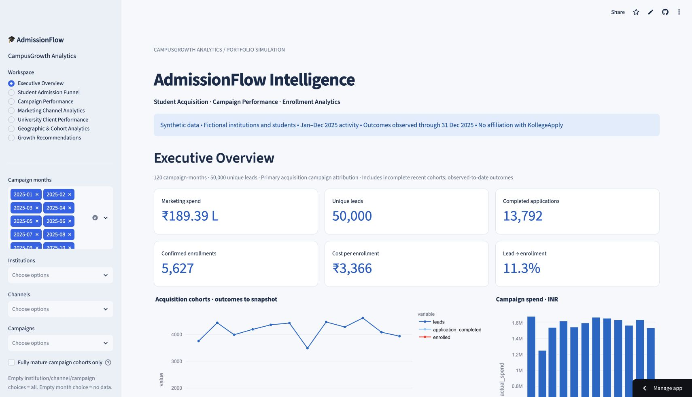
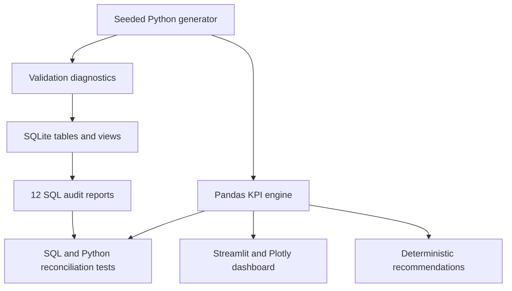

# AdmissionFlow Intelligence
### Student Admission Funnel & Marketing Campaign Optimization

**CampusGrowth Analytics · Portfolio simulation · Python / SQL / Streamlit**

**[Open the live application](https://student-admission-funnel-analytics.streamlit.app/)** — deployed on Streamlit Community Cloud with Python 3.12; verified loading on 18 October 2026.



A reproducible decision-support platform for a fictional Indian higher-education marketing organization. Follow students from acquisition through enrollment, compare campaign costs without double-counting spend, and build an evidence-backed investigation queue for a marketing management review.

**All students, institutions, commercial values and outcomes are synthetic. This is not KollegeApply data, a client engagement, an empirical channel benchmark, or evidence of causal marketing uplift.** No student identities or contact information are included.

## Business problem and objectives
Institutional campaign managers need to distinguish lead volume from completed applications and enrollments, identify application friction, monitor budgets, and explain which campaign segments merit investigation. This project supports those workflows using a single consistent KPI layer, SQL audits and downloadable CSV reports.

## Quick start
Requires Python 3.12; no account, API key or paid service required.

```bash
git clone https://github.com/harshvtomar/student-admission-funnel-analytics.git
cd student-admission-funnel-analytics
python -m venv .venv
# macOS / Linux
source .venv/bin/activate
# Windows alternative: .venv\Scripts\activate
pip install -r requirements.txt
python -m src.pipeline
streamlit run app.py
```

The pipeline recreates compressed CSV tables, a constrained SQLite database, validation diagnostics, all 12 SQL reports and KPI/recommendation exports. Compressed CSV tables, the deterministic generator and canonical CSV hashes are versioned. The derived SQLite database is rebuilt locally. The dashboard generates and caches the same simulation directly, avoiding stale or damaged local database caches. The generated files contain no real personal information.

## Dataset and provenance
- Fixed seed **20261018**, 50,000 unique synthetic students, 24 fictional institutions, 120 monthly campaigns, 8 markets, 7 channels.
- Campaign activity: **1 January–31 December 2025**. Snapshot: **31 December 2025 23:59:59**, simulated India local time.
- 79,321 achieved funnel events; 5,627 confirmed enrollment records in this seed.
- A lead has one immutable primary acquisition campaign and one institution. No multi-touch interactions are generated.
- Budget and non-paid-channel operating costs are hypothetical. No tuition revenue, ROI or profit is modeled.

Public-data investigation considered [AISHE](https://aishe.gov.in/), [OGD enrollment statistics](https://www.data.gov.in/resource/state-and-ugc-faculty-group-wise-student-enrollment-universities-and-colleges-2012-2013) and [UCI Higher Education Students Performance Evaluation](https://archive.ics.uci.edu/dataset/856/higher%2Beducation%2Bstudents%2B). These do not supply the linked Indian campaign/spend/student-event CRM required here. No third-party rows were imported, and the synthetic probabilities are not calibrated to these sources. See [provenance](docs/DATA_PROVENANCE.md).

## Architecture and technology


`src/generate.py` produces the five relational tables; `src/validate.py` checks IDs, foreign keys, chronology and funnel integrity; `src/database.py` builds SQLite using `sql/schema.sql`; `src/metrics.py` implements filters and KPIs; `src/recommendations.py` produces actionable diagnostics; `src/pipeline.py` orchestrates reproducible exports; `app.py` presents seven workspaces.

## Seven dashboard pages
1. **Executive Overview:** spend, unique leads, applications, enrollments, CPE, conversion, monthly trends and management review.
2. **Student Admission Funnel:** unique-student stages, stage gaps and geography filtering; aggregate reach explicitly separated.
3. **Campaign Performance:** cost/conversion scatter and downloadable campaign scorecards.
4. **Marketing Channel Analytics:** costs and conversion across seven acquisition channels.
5. **University Client Performance:** institution enrollment and efficiency tables, plus filtered HTML reports and ZIP report/CSV packs.
6. **Geographic & Cohort Analytics:** territory conversion and cohort follow-up maturity.
7. **Growth Recommendations:** reproducible campaign investigation queue and a constrained fixed-budget planner with mature historical unit costs and editable scenario assumptions.

Sidebar filters cover complete campaign months, institution, channel, campaign and fully mature cohorts. Empty selections have defined behavior. INR labels, tooltips and CSV downloads are included.

## Key metric rules
| Metric | Numerator / denominator |
|---|---|
| CTR / CPC | Clicks / impressions; spend / clicks |
| CPL / qualified rate | Spend / unique leads; qualified / leads |
| Application start / completion rates | Started / qualified; completed / started |
| Lead-to-application | Completed applications / unique leads |
| Application-to-enrollment | Confirmed enrollments / completed applications |
| Lead-to-enrollment | Confirmed enrollments / unique leads |
| Cost per application / enrollment | Spend / completed applications; spend / confirmed enrollments |
| Budget utilization | Actual spend / allocated campaign budget |

All outcomes are **observed through the fixed snapshot** for the selected acquired students. Costs use whole campaign-month totals, including campaigns with no conversions. Ratios use pooled numerators and denominators, not averages of individual ratios. Zero denominators are undefined (NaN in Python, NULL in SQL, N/A in cards). Individual maturity requires 90 days of follow-up; the comparable campaign filter conservatively requires campaign end + 91 days to fall before the snapshot. Recommendations use only these fully mature campaign cohorts and at least 100 leads per campaign. See [methodology](docs/METHODOLOGY.md) and [complete data dictionary](docs/DATA_DICTIONARY.md).

## Testing and reproducibility
```bash
python -m pytest -q --junitxml=reports/pytest.xml
```

Independent arithmetic fixtures, adversarial data mutations, foreign-key enforcement, generation reproducibility, SQL/Python comparisons, filtering, empty states and Streamlit AppTest runs cover all seven pages. GitHub Actions regenerates the dataset and runs the suite on pushes and pull requests. Actual session results are recorded in [SESSION_LOG.md](SESSION_LOG.md); committed reports are the fixed simulation snapshot and regenerate with the pipeline.

## Limitations and planned improvements
- Synthetic patterns demonstrate analysis capabilities; they cannot establish real Indian market demand or channel effectiveness.
- Single acquisition attribution is not causal impact; real multi-touch activity and identity resolution are out of scope.
- Recent cohorts are right-censored; observed conversion is not a survival estimate or standardized 90-day conversion.
- Impressions/clicks are interaction counts, not unique people. Geography cost metrics are intentionally unavailable.
- Enrollment records represent confirmations only. Declines, withdrawals, rejections and refunds are not modeled separately; absent progression does not imply permanent rejection.
- Exact duplicate repair is available, but conflicting IDs require explicit resolution rather than silent deletion. The shipped seed is clean.
- SQLite uses floating-point INR amounts rounded to two decimals; calculations are reconciled within floating-point tolerance, not accounting-grade decimal arithmetic.
- Budget planning assumes constant historical efficiency, not incremental causal returns. Full accessibility certification, real CRM integration and experimentally estimated response curves remain future work.

## Business reporting deliverables

- [Excel business workbook](reports/session2/AdmissionFlow_Business_Report.xlsx): executive controls, campaigns, channels, funnel, institutions, geography, editable scenarios and a guide; 904 formulas and six charts.
- [Leadership presentation](reports/session2/AdmissionFlow_Leadership.pptx) and [PDF](reports/session2/AdmissionFlow_Leadership.pdf): ten slides with editable charts in the PPTX.
- [Executive management report](reports/session2/EXECUTIVE_REPORT.md) and [24 institution report packs](reports/session2/institutions).
- [Budget methodology](docs/BUDGET_METHODOLOGY.md), [refresh instructions](docs/REPORT_REFRESH.md), [interview guide and resume bullets](docs/INTERVIEW_GUIDE.md), and [delivery verification](docs/DELIVERY_STATUS.md).

Run `python -m src.export_business` to regenerate reporting inputs and institution packs. Excel and slide builders use the separately documented artifact-authoring runtime; this is not a dependency of the deployed application. The default ₹10 lakh scenario yields 302.2 / 377.8 / 444.5 modeled enrollment equivalents under assumed cost multipliers 1.25 / 1.00 / 0.85. These are planning calculations, not forecasts.

Continue from [NEXT_SESSION_PROMPT.md](NEXT_SESSION_PROMPT.md). Do not rebuild or modify unrelated repositories.
